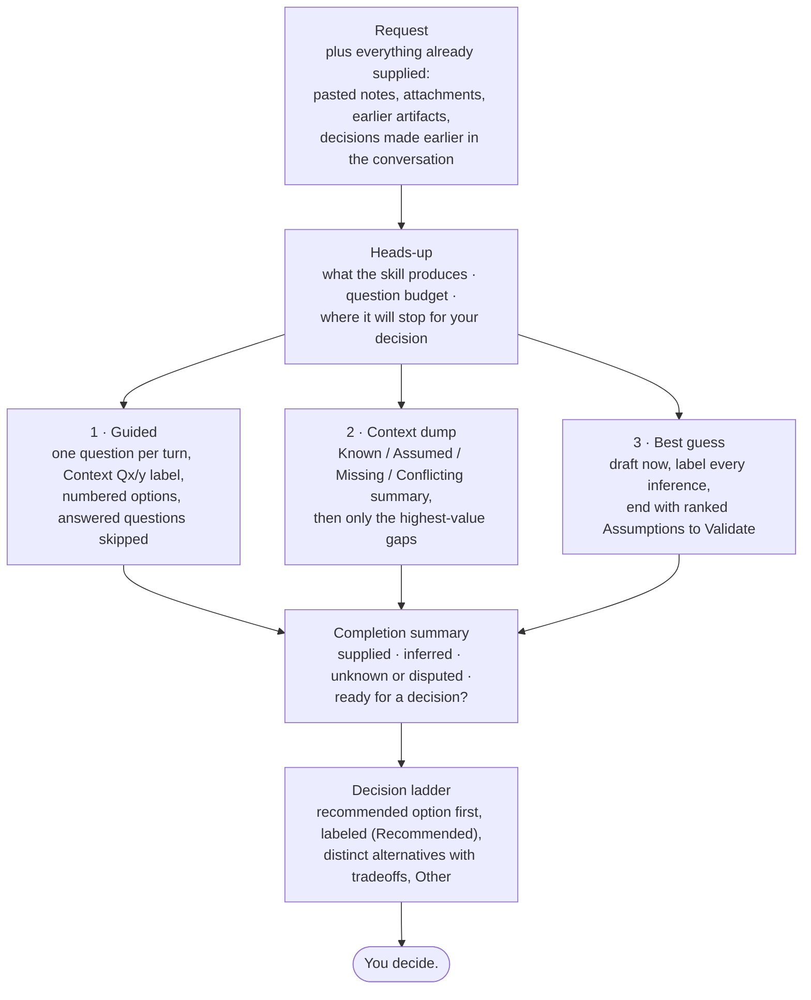

# Guided Context Capture

Guided Context Capture is how every interactive skill in this library gathers context and hands the decision back to you. You can show up with a complete brief, a messy paste, or nothing at all, and the skill meets you where you are. It never asks you for something you already gave it, and it never presents a guess as a fact.

The rules live in one place: [`skills/workshop-facilitation/SKILL.md`](../skills/workshop-facilitation/SKILL.md). This page explains why the contract exists, what it looks like from the user's side, and how it stays consistent across the library.

## Why It Exists

A product manager should not need a perfect brief before getting useful help. They also should not be pushed through a questionnaire when the answer is already in a pasted doc, an earlier artifact, or the request itself.

Most AI-assisted workflows fail one of two ways:

- **The interrogation.** Ten questions dumped at once, half of them already answered in the paste. The user gives up or answers carelessly.
- **The confident fabrication.** The agent fills every gap silently and hands back a polished artifact. Inferences read like facts, and nobody can tell which parts to check.

Guided Context Capture keeps incomplete context usable without letting hidden assumptions pass as evidence. It is also a teaching device. By the end, the PM can see which parts of their thinking were supported, which were inferred, and which are still open. That habit is worth more than any single artifact.

## The Shape of the Contract



All three entry modes end at the same completion summary and the same decision. The mode changes how context is gathered. It never changes what you see before deciding, and it never moves the decision from you to the skill.

## The Seven Moves

| # | Move | What you see | Why it matters |
|---|---|---|---|
| 1 | **Heads-up** | What the skill will produce, about how many questions, where it will stop for your call, and three ways in | No surprise length. You pick the pace |
| 2 | **Start from what you supplied** | Inline text, pastes, and earlier decisions count as answers. The progress label starts at the first real gap (`Context Q3/6`) | Re-asking tells the user nobody was listening |
| 3 | **One question per turn** | A progress label, one plain-language question, numbered options ending in `Other`, and multi-select (`1,3`) | Batched questions get batched, careless answers |
| 4 | **Options get sharper each turn** | Early options use typical examples. Later ones use the specifics you've given | Generic options are filler. Specific ones show the skill was listening |
| 5 | **Context dump shows its read first** | A **Known / Assumed / Missing / Conflicting** summary before any question, with what a source *reported* kept apart from what is *verified* | You can correct a misreading before it spreads into the artifact |
| 6 | **Interruption-safe** | Meta questions answered on the spot, mode switches honored at once, "go back to Q2" replays that question with updated options, pause means pause, resume opens with a recap | Real conversations wander. The protocol bends without breaking |
| 7 | **Summary, then the decision ladder** | Supplied / inferred / unknown / ready-to-decide recap, confirmation before generating, then a numbered ladder: the option the evidence favors first `(Recommended)`, two or three real alternatives with one-line tradeoffs, `Other` | The skill recommends. You decide |

Best guess mode always ends with **Assumptions to Validate**, ranked by how much each assumption could change the decision. A flat list hides which guess is holding up the whole plan.

## What a Context Dump Read Looks Like

A PM pastes three paragraphs about a dispatch-scheduling feature and asks for a PRD. Before asking anything, the skill shows its read:

> **Here's what I took from your notes:**
>
> - **Known:** Target users are dispatchers at mid-size field service companies (your notes). Launch target is Q2 (your notes).
> - **Assumed:** "Reduce no-shows" means technician no-shows, not customer no-shows. I inferred this from the scheduling context. Correct me if it's wrong.
> - **Missing:** Success metric and baseline. Who signs off on scope.
> - **Conflicting:** Your notes say "SMB first" and "our enterprise pilot accounts." Which segment is v1 for?
>
> Two questions would most change this PRD. First one:
>
> `Context Q1/2` — **Which segment is v1 for?** …

Look at what the skill did *not* do. It didn't ask about users or timing, because those were already supplied. It didn't quietly resolve the conflict. It didn't list every possible gap, only the ones that would change the artifact.

## How It Differs From the Usual Approach

- **One source of truth, not copied text.** Many skill libraries paste a facilitation block into every skill and enforce matching wording. Here each interactive skill links to `workshop-facilitation`, so a fix lands everywhere at once and no skill depends on another's internals. (This matches the library's rule against tight coupling between skills.)
- **Plain-language input, no templating.** Context arrives through each skill's `## Input` section, which works the same in every runtime. See the `$ARGUMENTS` rationale in [CONTRIBUTING.md](../CONTRIBUTING.md).
- **Labels carry through.** The Known / Assumed / Missing / Conflicting read uses the same Fact / Inference / Assumption discipline as [`autonomous-investigation`](../skills/autonomous-investigation/SKILL.md). Guided sessions and autonomous research speak the same language about evidence.

## Setting the Default Entry Mode

Guided is the default when nothing else is set. That fits a library whose job is half teaching, because one question at a time is where a PM learns the framework. Teams that usually show up with notes in hand may prefer to open in Context dump, so the library lets you change the default without editing 33 skills.

The master setting is [`pm-skills.config.yaml`](../pm-skills.config.yaml) at the repo root:

```yaml
facilitation:
  default_entry_mode: guided        # guided | context-dump | best-guess
  overrides:
    incoming-request-advisor: context-dump
```

- **`default_entry_mode`** applies to every skill that runs the protocol.
- **`overrides`** set a different default for one skill, by folder name. `incoming-request-advisor` ships as Context dump because the pasted message *is* the context.
- **The user's choice always wins.** The default only decides how the first turn opens. All three modes are still offered, and the user can switch at any point. This is a dial the user sets, not a setting that takes the choice away.

**How the setting reaches the agent.** Every skill that runs the protocol carries one line, `**Default entry mode:** Guided · …`, so a skill installed on its own (a single Claude Desktop ZIP, say) still knows its default. Agents working inside the repo can read the config file directly. Precedence: the user's choice in the session › the config file › the skill's own line › Guided.

**Changing it:**

1. Edit `pm-skills.config.yaml`.
2. Run `python3 scripts/apply-entry-mode.py` to rewrite the line in every affected skill.
3. Build as usual. `package-claude-skills.sh` and `build-codex-skills.sh` apply the config to packaged copies too, and `validate-skills.sh` fails if `skills/` has drifted from the config.

If you fork the library for a team, this is the one setting most worth tuning. Use Best guess as a library-wide default only if your people reliably read the ranked Assumptions to Validate list. Otherwise it trains them to ship guesses.

## Grounding Options When Domain Context Is Thin

When the skill lacks domain knowledge to offer sharp options and the runtime has web search, it should search before offering options, so the choices reflect real roles, products, and workflows. When search isn't available, it should say the options are typical examples and ask the user to correct them. Either way, it must not invent specifics just to make an option look sharp.

## Maintaining It

1. Change behavior in [`skills/workshop-facilitation/SKILL.md`](../skills/workshop-facilitation/SKILL.md) first.
2. Find the skills that inherit it with the scope query in [`docs/maintenance/facilitation-scope.md`](maintenance/facilitation-scope.md), and patch only the ones whose local wording contradicts the change.
3. Update this page if the user-visible contract changes.
4. A new interactive skill that runs the protocol needs the `**Default entry mode:**` line (copy it from any advisor). Then run `python3 scripts/apply-entry-mode.py --check`.

Worked transcripts: [`skills/workshop-facilitation/examples/inline-input-flow.md`](../skills/workshop-facilitation/examples/inline-input-flow.md).
